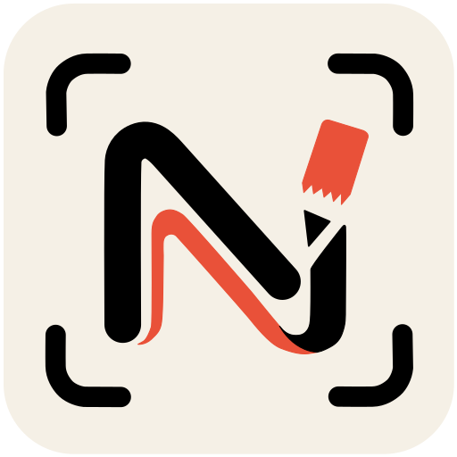
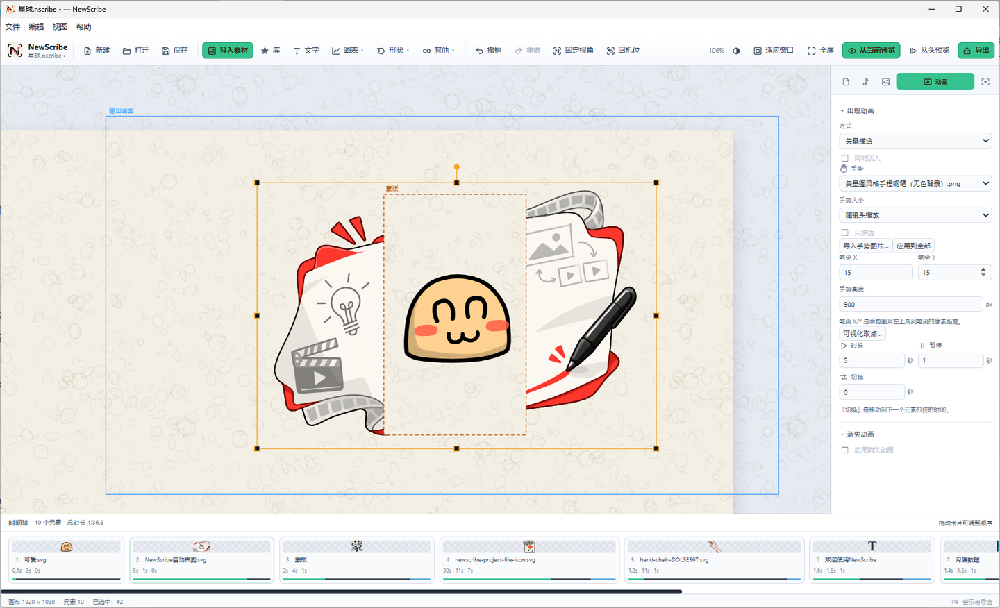

<div align="center">
  
  <h1>NewScribe</h1>
  <p><strong>手绘白板动画工作台</strong><br>
  在画布上摆放素材，用手势、镜头和时间轴把它们画成视频。</p>

  <p>
    
    
    
    
  </p>

  <p>
    <a href="https://github.com/eguersi/NewScribe/releases">下载 / Releases</a>
    ·
    <a href="https://eguersi.github.io/NewScribe/">官网</a>
    ·
    <a href="https://eguersi.github.io/NewScribe/help-web/zh/index.html">帮助中心</a>
    ·
    <a href="LICENSE">MIT License</a>
  </p>
</div>



NewScribe 是一个**本地优先**的手绘白板动画工作台。它不替你套模板，也不要求把素材上传到云端：在画布上摆放图片、SVG、文字、图形、图表、表格、二维码、公式、分子结构和国际音标，设置逐笔出现、手势、镜头和时间轴，最后导出带背景音乐的 MP4。

> NewScribe 受 Sparkol VideoScribe 启发，但不包含任何 VideoScribe 代码。

## 目录

- [功能](#功能)
- [下载](#下载)
- [快速开始](#快速开始)
- [构建安装包](#构建安装包)
- [界面与帮助](#界面与帮助)
- [项目结构](#项目结构)
- [技术栈](#技术栈)
- [开发说明](#开发说明)
- [许可证与致谢](#许可证与致谢)

## 功能

- **图片与 SVG**：导入、拖放、缩放、旋转、水平翻转
- **逐笔动画**：矢量描绘沿 SVG 路径描边再填充；位图描绘按内容区域涂抹
- **手势与镜头**：手绘手势、镜头固定、缩放、平移和关键帧
- **文字与排版**：字体、字号、颜色、粗斜体、下划线、删除线、对齐、打字机
- **图表**：折线图、条形图、饼图
- **表格**：单元格编辑、表头、字体、边框、对齐，可导出 CSV
- **二维码**：内容、纠错、前后景色、透明背景，可导出 PNG
- **图形**：矩形、三角形、平行四边形、梯形、圆形、星形、爱心、箭头和不规则图形；内置节点/贝塞尔编辑器，可导出 SVG
- **公式**：MathJax，支持 LaTeX、物理公式和 mhchem 化学式
- **国际音标**：X-SAMPA 自动转换为 IPA
- **分子结构**：RDKit WASM，SMILES 输入，内置常用模板
- **VideoScribe 导入**：读取 `.scribe` 工程，包括其中的折线图、条形图和饼图，并转换为可编辑图表
- **导出**：WebCodecs 逐帧编码 H.264/AAC MP4
- **界面**：中文 / English，深浅色主题，可自定义强调色

## 下载

安装包发布在 [GitHub Releases](https://github.com/eguersi/NewScribe/releases)。

| 平台 | 状态 | 说明 |
| --- | --- | --- |
| Windows 10 / 11 x64 | 可构建 | NSIS 安装包；当前未签名，可能出现 SmartScreen 提示 |
| macOS Apple Silicon / Intel | 可构建 | DMG / ZIP；正式分发需要 Developer ID 签名和公证 |
| Linux | 尚未打包 | 需要补充 AppImage / deb 配置和实机测试 |

> 如果 Releases 里还没有安装包，说明当前版本仍在准备发布。可以按下方步骤从源码运行。

## 快速开始

环境要求：

- Node.js 22+
- pnpm 12
- Windows 10/11 或 macOS

```bash
git clone https://github.com/eguersi/NewScribe.git
cd NewScribe
pnpm install
pnpm dev
```

首次启动需要几秒钟。

Windows 也可以双击 `启动 NewScribe.cmd`；macOS 可以双击 `启动 NewScribe.command`。如果从 Windows 复制到 Mac 后双击没有反应：

```bash
chmod +x "启动 NewScribe.command"
```

## 构建安装包

```bash
# 类型检查
pnpm typecheck

# 前端 / 主进程构建
pnpm build

# Windows NSIS 安装包
pnpm dist:win

# macOS DMG + ZIP
pnpm dist:mac
```

Windows 和 macOS 的打包配置在 [`electron-builder.yml`](electron-builder.yml)。macOS 的签名、公证和 ad-hoc 签名说明见 [`MAC-HANDOFF.md`](MAC-HANDOFF.md)。

发布安装包的步骤、文件命名和 GitHub Releases 说明见 [`RELEASING.md`](RELEASING.md)。

## 界面与帮助

- 官网：<https://eguersi.github.io/NewScribe/>
- 中文帮助：<https://eguersi.github.io/NewScribe/help-web/zh/index.html>
- English help：<https://eguersi.github.io/NewScribe/help-web/en/index.html>

官网和帮助由 GitHub Pages 发布。仓库的 Pages Source 需要设为 **GitHub Actions**；`docs/index.html` 是官网首页，`docs/help-web/` 是帮助页面。

帮助网页也可以直接打开：

```text
docs/help-web/zh/index.html
docs/help-web/en/index.html
```

## 项目结构

```text
src/
  main/          Electron 主进程
  preload/       preload 桥接
  renderer/      React 编辑器
  shared/        共享类型
build/           图标、安装器资源和 macOS 打包钩子
docs/            官网和静态帮助网页
scripts/         安装辅助脚本
.github/         GitHub Pages 工作流
```

## 技术栈

- Electron 45
- React 19 + TypeScript
- Canvas 2D 渲染
- Zustand 状态管理
- Vite / electron-vite
- WebCodecs + mp4-muxer
- MathJax + mhchem
- RDKit WASM
- electron-builder

## 开发说明

- 工程文件：`.nscribe` 本地工程；`.nspkg` 单文件分享包；`.scribe` 仅作导入
- 素材和工程默认保存在本地
- 当前 Windows 安装器由 NSIS 生成，安装时可选关联 `.scribe` 和创建桌面快捷方式
- macOS 打包会使用 `build/afterPack.cjs` 做无证书时的 ad-hoc 签名；正式发布仍需 Developer ID 和公证
- 更新时需要同步 GitHub 仓库和本地测试目录 `NewScribe`；本地测试目录可能包含测试素材和日志，不应直接提交

## 许可证与致谢

NewScribe 以 [MIT License](LICENSE) 发布。

作者：**祝鱼贵（Eguersi）**

- NewScribe logo 和 `.nscribe`、`.nspkg`、`.scribe` 文件格式图标由 Eguersi 设计
- 代码使用 DeepSeek V4.1 Flash 1017 模型进行 Vibe Coding 制作
- 受 Sparkol VideoScribe 启发，但不包含 VideoScribe 代码

如果觉得 NewScribe 有用，欢迎在 GitHub 点个 Star：

<https://github.com/eguersi/NewScribe>

---

## English

NewScribe is a local-first whiteboard animation studio for Windows and macOS. Place images, SVG, text, shapes, charts, tables, QR codes, formulas, molecules, and IPA on a canvas; animate them with hand-drawn reveals, gestures, camera moves, and a timeline; then export an MP4.

It is inspired by Sparkol VideoScribe but contains no VideoScribe code. The project is MIT-licensed and built with Electron, React, TypeScript, Canvas 2D, and WebCodecs.

- Website: <https://eguersi.github.io/NewScribe/>
- Releases: <https://github.com/eguersi/NewScribe/releases>
- Help: <https://eguersi.github.io/NewScribe/help-web/en/index.html>
